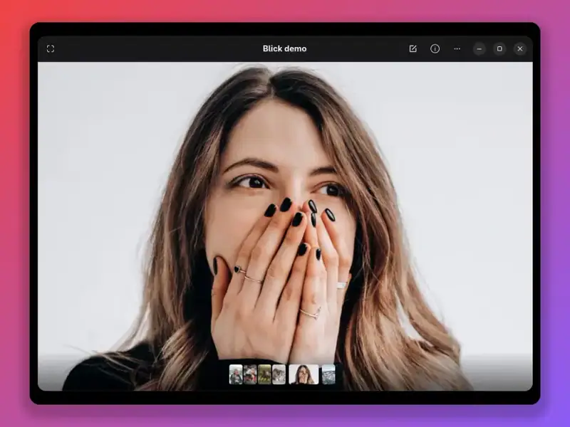
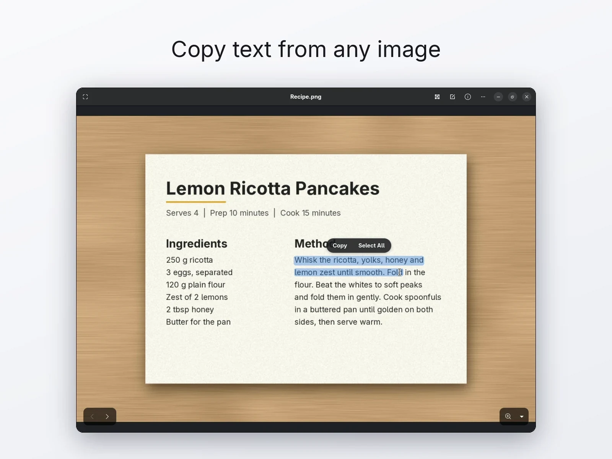

<p align="center">
  
</p>

<div align="center">

# Blick (previously Glance)

**Image viewer, video player and photo editor for Linux**

*Previously Glance*

[](https://github.com/Replexo/Blick/releases/latest)
[](COPYING.md)
[](https://gtk.org)



</div>

Blick is a fast image viewer, video player and photo and video editor for Linux and GNOME. Open a picture, annotate it, adjust its colours, crop it, copy the text in it, and save, all in the same window. Videos play in the same window and can be trimmed, muted, rotated and saved smaller. It is a fork of [Loupe](https://gitlab.gnome.org/GNOME/loupe), the GNOME image viewer, so browsing stays fast, sandboxed and touch-friendly.

Blick was called **Glance** up to version 1.2. Installing Blick replaces Glance: the files Glance opened open in Blick, and the Flatpak takes Glance's settings along.

Blick runs on any Linux desktop and comes as a Flatpak, an AppImage, and packages for Debian and Ubuntu, Fedora and Arch Linux.

## Features

- **Viewer:** everything from Loupe, plus a floating strip of the photos in the folder.
- **Video player:** subtitles, audio tracks, speed, repeat and resume, in the style of GNOME's video player.
- **Video editing:** frame-accurate trimming, mute, rotate and smaller copies, plus Crop, Adjust and Markup.
- **Markup:** brush, highlighter, shapes, arrows and text, in any colour, all editable later.
- **Adjust:** brightness, contrast, highlights, shadows and saturation.
- **Crop:** aspect ratios, rotate, flip, resize, straighten and perspective.
- **Live text:** select and copy text from any image or paused video, offline with Tesseract.
- **Undo and redo** across every edit, and **Save a Copy** or **Replace Original**.
- **Translated** into Spanish, German, French, Brazilian Portuguese, Russian, Polish and Turkish.

<p align="center">
  
</p>

## Install

Download the file for your system from the [latest release](https://github.com/Replexo/Blick/releases/latest):

| System | File | Install |
|---|---|---|
| Any Linux (Flatpak) | [`Blick-1.3-x86_64.flatpak`](https://github.com/Replexo/Blick/releases/latest/download/Blick-1.3-x86_64.flatpak) | `flatpak install --user Blick-1.3-x86_64.flatpak` |
| Any Linux (AppImage) | [`Blick-1.3-x86_64.AppImage`](https://github.com/Replexo/Blick/releases/latest/download/Blick-1.3-x86_64.AppImage) | `chmod +x Blick-1.3-x86_64.AppImage`, then run it |
| Ubuntu 25.10 and newer | [`blick_1.3_amd64.deb`](https://github.com/Replexo/Blick/releases/latest/download/blick_1.3_amd64.deb) | `sudo apt install ./blick_1.3_amd64.deb` |
| Fedora 43 and newer | [`blick-1.3-1.fc43.x86_64.rpm`](https://github.com/Replexo/Blick/releases/latest/download/blick-1.3-1.fc43.x86_64.rpm) | `sudo dnf install ./blick-1.3-1.fc43.x86_64.rpm` |
| Arch Linux | [`blick-1.3-1-x86_64.pkg.tar.zst`](https://github.com/Replexo/Blick/releases/latest/download/blick-1.3-1-x86_64.pkg.tar.zst) | `sudo pacman -U blick-1.3-1-x86_64.pkg.tar.zst` |

The Flatpak uses the GNOME 51 runtime, which Flatpak downloads from [Flathub](https://flathub.org/setup) if you don't have it yet. Blick is coming to Flathub itself soon, with automatic updates. You can check your download against `SHA256SUMS` on the release page.

To build it yourself instead, see [Build from source](#build-from-source).

### Coming from Glance

Install Blick, start it once, and it takes over the files Glance opened. Remove Glance afterwards, for example with `flatpak uninstall io.github.Replexo.Glance` or your package manager.

## Keyboard shortcuts

| Key | Action |
|---|---|
| <kbd>E</kbd> | Open the editor |
| <kbd>C</kbd> | Crop |
| <kbd>A</kbd> | Select, move and resize markup |
| <kbd>B</kbd> | Brush |
| <kbd>L</kbd> / <kbd>Shift</kbd>+<kbd>L</kbd> | Line / arrow |
| <kbd>R</kbd> / <kbd>O</kbd> | Rectangle / ellipse |
| <kbd>T</kbd> | Text |
| <kbd>E</kbd> (in the editor) | Eraser |
| <kbd>Shift</kbd> while drawing | Squares, circles and lines at 45° steps |
| <kbd>Ctrl</kbd>+<kbd>Z</kbd> / <kbd>Ctrl</kbd>+<kbd>Shift</kbd>+<kbd>Z</kbd> | Undo / redo |
| <kbd>Ctrl</kbd>+<kbd>S</kbd> / <kbd>Ctrl</kbd>+<kbd>Shift</kbd>+<kbd>S</kbd> | Replace original / save a copy |
| <kbd>Space</kbd> | Play or pause a video |
| <kbd>←</kbd> / <kbd>→</kbd> | Skip a video back or forward ten seconds |
| <kbd>,</kbd> / <kbd>.</kbd> | Previous / next frame of a video |
| <kbd>M</kbd> / <kbd>F</kbd> | Mute / fullscreen a video |

All shortcuts are listed under **Keyboard Shortcuts** in the main menu.

## Build from source

You need GTK 4.20, libadwaita 1.8, libgweather 4, libseccomp, the glycin loaders, Tesseract 5 with Leptonica, and Rust 1.93 or newer.

```sh
meson setup builddir
ninja -C builddir
ninja -C builddir install
```

To build and install the Flatpak:

```sh
flatpak-builder --user --install --install-deps-from=flathub build-flatpak build-aux/flatpak/io.github.Replexo.Blick.json
```

To build a development version with its own app ID, so it can sit next to an installed release:

```sh
meson setup builddir -Dprofile=dev -Dapp_id_suffix=.Devel
```


### Privacy and network access

Blick only goes online to check GitHub for updates. Your photos and videos never leave your computer, and there are no accounts or analytics. To keep the Flatpak offline, run `flatpak override --user --unshare=network io.github.Replexo.Blick`. Once Blick is on Flathub, which handles updates itself, the update check and the network access will be removed.

## Contributing

Bug reports and ideas are welcome in the [issue tracker](https://github.com/Replexo/Blick/issues). See [CONTRIBUTING.md](CONTRIBUTING.md) before opening a pull request.

## Credits

- Based on [Loupe](https://gitlab.gnome.org/GNOME/loupe) by Christopher Davis, Sophie Herold and the GNOME contributors.
- Icons from [MingCute Icons](https://www.mingcute.com/) (Apache-2.0) and [coolicons](https://github.com/krystonschwarze/coolicons) (MIT). See `data/COPYING.mingcute` and `data/COPYING.coolicons`.
- The set of markup tools follows [Gradia](https://github.com/AlexanderVanhee/Gradia).
- Text recognition by [Tesseract](https://github.com/tesseract-ocr/tesseract) (Apache-2.0).
- Translations of the viewer come from the Loupe translators.

## License

Blick is free software, released under the [GNU General Public License, version 3 or later](COPYING.md).
